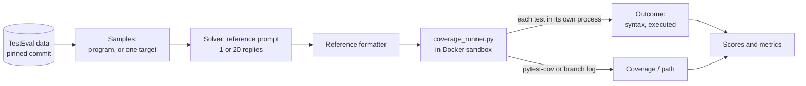

# TestEval

[TestEval](https://arxiv.org/abs/2406.04531) (Wang et al., NAACL 2025 Findings) measures how well language models write unit tests. Each task gives the model a LeetCode Python program and its description and asks for pytest-style test methods; the generated tests run in a Docker sandbox and are scored with coverage.py. This is a port of the authors' [reference implementation](https://github.com/LLM4SoftwareTesting/TestEval) to Inspect. It reproduces the reference scorers exactly (see [Parity with the reference implementation](#parity-with-the-reference-implementation)).

<!-- Contributors: Automatically Generated -->
Contributed by [@MFayizE](https://github.com/MFayizE)
<!-- /Contributors: Automatically Generated -->

<!-- Usage: Automatically Generated -->
## Usage

First, install dependencies:

```bash
uv sync
```

Then run evaluations:

```bash
uv run inspect eval inspect_testeval/testeval_overall --model openai/gpt-5-nano
uv run inspect eval inspect_testeval/testeval_line --model openai/gpt-5-nano
uv run inspect eval inspect_testeval/testeval_branch --model openai/gpt-5-nano
uv run inspect eval inspect_testeval/testeval_path --model openai/gpt-5-nano
```

You can also import tasks as Python objects:

```python
from inspect_ai import eval
from inspect_testeval import testeval_overall, testeval_line, testeval_branch, testeval_path
eval(testeval_overall)
```

If your directory name doesn't match your package name but you have registered your eval task, you can also run:

```bash
uv run inspect eval testeval_overall --model openai/gpt-5-nano
```

After running evaluations, view logs with:

```bash
uv run inspect view
```

If you don't want to specify `--model` each time, create a `.env` file:

```bash
INSPECT_EVAL_MODEL=anthropic/claude-opus-4-1-20250805
ANTHROPIC_API_KEY=<anthropic-api-key>
```
<!-- /Usage: Automatically Generated -->

<!-- Options: Automatically Generated -->
## Options

You can control a variety of options from the command line. For example:

```bash
uv run inspect eval inspect_testeval/testeval_overall --limit 10
uv run inspect eval inspect_testeval/testeval_line --max-connections 10
uv run inspect eval inspect_testeval/testeval_branch --temperature 0.5
```

See `uv run inspect eval --help` for all available options.
<!-- /Options: Automatically Generated -->

<!-- Parameters: Automatically Generated -->
## Parameters

### `testeval_overall`

- `num_tests` (int): Tests requested per program (the paper uses 20). (default: `20`)
- `ks` (Sequence[int]): Group sizes for cov@k. (default: `(1, 2, 5)`)
- `shuffle` (bool | int): Dataset order: a seed, ``True`` for an unseeded shuffle, or ``False``. (default: `42`)
- `cov_at_k_seed` (int): Seed for splitting each program's tests into cov@k groups. (default: `42`)

### `testeval_line`

- `shuffle` (bool | int): Sample order: a seed, ``True`` for an unseeded shuffle, or ``False``. (default: `42`)

### `testeval_branch`

- `shuffle` (bool | int): Sample order: a seed, ``True`` for an unseeded shuffle, or ``False``. (default: `42`)

### `testeval_path`

- `shuffle` (bool | int): Sample order: a seed, ``True`` for an unseeded shuffle, or ``False``. (default: `42`)

<!-- /Parameters: Automatically Generated -->

## Tasks

| Task | Samples | The model is asked for | Main metric |
| --- | --- | --- | --- |
| `testeval_overall` | 210 programs | 20 different tests per program, in one conversation | line and branch coverage of all its tests, and cov@k |
| `testeval_line` | 1,340 target lines | one test that executes a given line | share of target lines covered |
| `testeval_branch` | 983 target branches | one test that enters a given branch | share of target branches covered, by difficulty |
| `testeval_path` | 854 target paths | one test that follows a given sequence of branch conditions | exact path match and path similarity |

Every task decodes with temperature 0 and at most 256 tokens per reply, as the paper does.

## Dataset

The 210 programs come from the authors' repository (MIT licence), pinned to commit [`6f67dee`](https://github.com/LLM4SoftwareTesting/TestEval/tree/6f67dee71de6ccda1767b8c219a93f4ae0a7ce90): LeetCode problems with a Python solution (9 easy, 100 medium, 101 hard). Each program comes with:

- target lines and target branches, each branch labelled easy, medium or hard by how often random tests cover it (498, 225 and 260 branches);
- sampled execution paths, given to the model as branch conditions and checked against a version of the program that logs every branch it enters.

`leetcode-py-all.jsonl` holds all of this in one file. The path task also reads `leetcode-py-instrumented.jsonl` from the same commit, because the reference path generator takes program descriptions from it: for 14 programs they keep exponents such as `10^9` that the other file has lost (`109`).

The overall task has one sample per program. The targeted tasks have one sample per target, whose input is the reference prompt for that target. Samples are shuffled with seed 42 by default, so `--limit N` sees a spread of programs; `-T shuffle=false` keeps the reference order.

## Scoring

Every generated reply first goes through the reference formatter (keep the test function up to the first call of the function under test, drop an incomplete last line, rename the function). A test then counts as:

- **syntax correct** if it compiles;
- **executable** if it runs within 5 seconds, a failing assertion included, and calls the function under test.

Each test runs in its own Python process inside the sandbox. Coverage is measured with pytest-cov, with branch coverage on and the reference `.coveragerc`.

**`testeval_overall`** reports `syntax_correctness` and `execution_correctness` over all generated tests, and per program the `line_coverage` and `branch_coverage` of its executable tests together, averaged over programs (a program without an executable test counts as 0, as in the reference). `line_cov@k` and `branch_cov@k` measure diversity: a program's executable tests are shuffled and split into groups of k, and the coverage of each group is averaged. The `_reference` keys use the reference code's definition instead, which averages the cumulative coverage after 1, 2, ..., k tests of each group.

**`testeval_line`** and **`testeval_branch`** report `syntax_correct`, `exec_correct` and `covered`: whether an executable test runs the target line, or the first line inside the target branch. Branch coverage is also reported for easy, medium and hard branches.

**`testeval_path`** reports `path_exact_match`, 1 when the whole target path appears unbroken in the branch log of an executable test, and `path_similarity`, the longest unbroken run of the target path found in the log, as a share of the path's length.

All targeted metrics are means over targets, so they equal the reference script's totals divided by the number of targets.

## Deviations from the original implementation

| What changed | Why | Expected effect on scores |
| --- | --- | --- |
| Each test runs in a fresh Python process inside a Docker sandbox (no network, non-root, all capabilities dropped, 1 GB memory). The reference runs every test with `exec()` inside the scorer's own process under a Unix-only `SIGALRM` timeout. | Model-written code must not run on the host. A fresh process also stops one test's globals or cached modules from affecting the next. | None on the parity data. One Meta-Llama-3-8B test (task 952) allocates a billion-element list: the reference scorer is killed, this port records a timeout. |
| `testeval_branch` reports `exec_correct` and `covered` by the paper's definition, and `exec_correct_reference` and `covered_reference` by the reference code's. | `eval_branchcov.py` tests `res != False`, so a test that raised an exception other than `AssertionError` counts as executable, unlike in the line and path scripts and the paper. | The `_reference` keys are higher. On the parity data, Meta-Llama-3-8B executable rate 0.731 vs 0.851, branch coverage 0.495 vs 0.507; gpt-4o differs by about 0.001. |
| `testeval_overall` reports cov@k by the paper's definition (Algorithm 1) and, as `_reference` keys, by the reference code's. | The reference code averages cumulative prefix coverage within each group; the paper takes each group's coverage. | The two agree for k = 1; for k > 1 the paper definition is higher. |
| For the 8 empty target paths, a test that enters no branch scores 1 in `path_exact_match` and `path_similarity`; the `_reference` keys score it 0. | The reference `match_path` divides by the path length; for an empty path a bare `except` turns the error into a score of 0 for every test. | On the parity data, 2 of 854 gpt-4o tests: exact match 0.5504 (reference) vs 0.5527. |
| A test whose coverage run writes no report scores 0 coverage and is listed in the score metadata. | The reference reads whatever `coverage.json` is in the folder, which can be an earlier test's report, or crashes when there is none. | None on the parity data. |
| `testeval_overall` asks for 20 tests per program by default. | The paper uses 20; the reference scripts default to 10. | Matches the paper. `-T num_tests=10` matches the scripts. |
| Assertion correctness, reported in the paper's tables, is not reported. | The reference code does not compute it, so there is no implementation to match. | Not available. |
| The paper's baselines (coverage of the first overall test on the targets) and the two-step chain-of-thought variant of the line task are not implemented. | They are comparisons for the paper's analysis, not separate benchmarks. | Not available. |

## Parity with the reference implementation

[`tools/parity/`](../../tools/parity/README.md) scores real model outputs with this port and with the unmodified reference scripts, in the same Linux image, and compares them. The outputs are gpt-4o and Meta-Llama-3-8B-Instruct replies published in the [HyunjoonCho/TestEval](https://github.com/HyunjoonCho/TestEval) fork (MIT), after the reference formatter, which this port's formatter reproduces on every one of them.

| Task | Compared | Result |
| --- | --- | --- |
| Overall (`eval_overall.py`) | 209 programs x 10 tests, per model | every metric matches (largest difference 1.1e-16); task 952 excluded, see above |
| Line (`eval_linecov.py`) | 1,340 targets per model | counts and covered targets match for every program |
| Branch (`eval_branchcov.py`) | 983 targets per model | counts and covered targets match for every program (`_reference` keys) |
| Path (`eval_pathcov.py`) | 854 targets per model | every test's results match (`_reference` keys) |

## Evaluation report

Results from full runs and a comparison with the paper's tables will be added here.

## Architecture



The scorer copies `coverage_runner.py` and a job file into the sandbox and runs it; the runner uses only the standard library, pytest and pytest-cov, and prints one JSON result.
